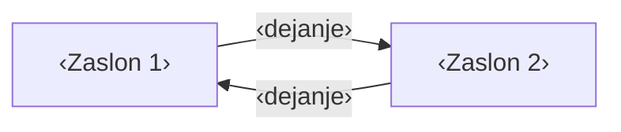
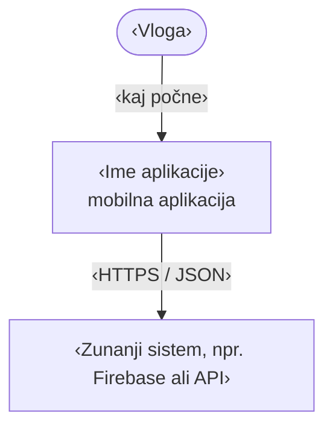
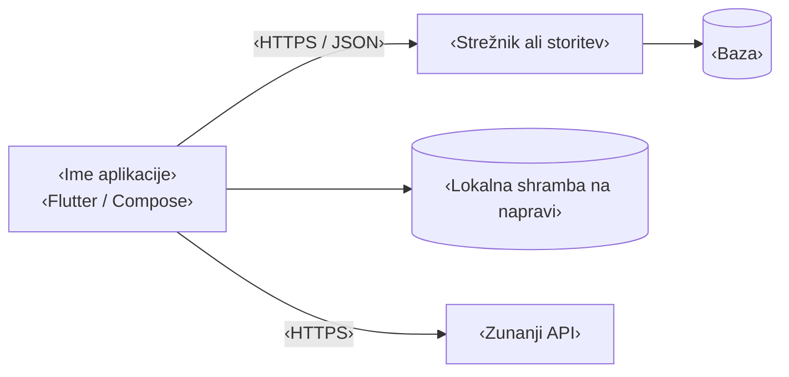
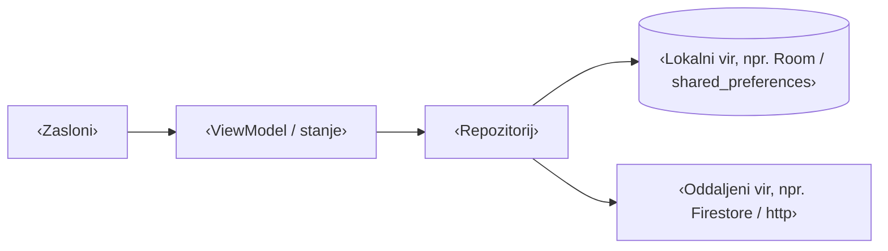
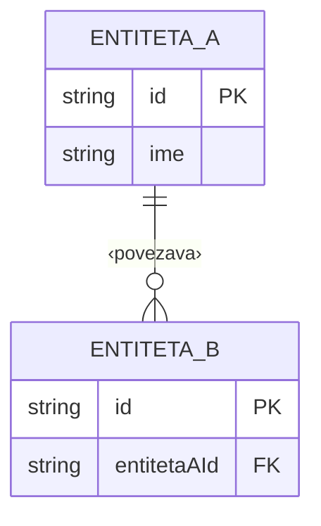
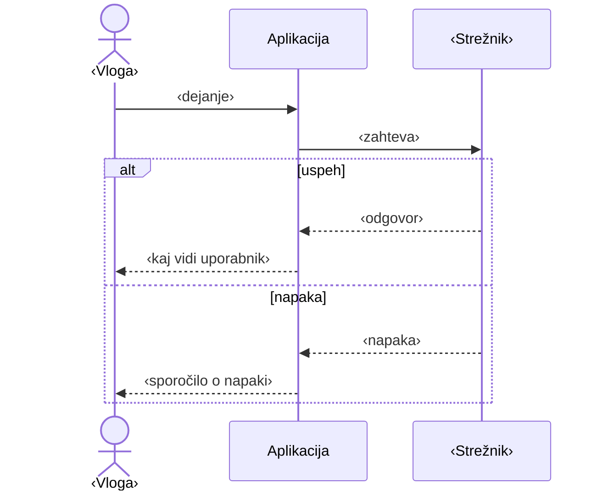
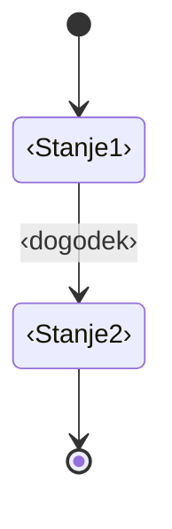

# ‹Ime aplikacije›: funkcionalna specifikacija

> **Kako uporabiti predlogo** (ta okvir pred oddajo pobrišite)
>
> - Datoteko skopirajte v svoj repozitorij kot **`docs/SPECIFIKACIJA.md`**, slike zaslonov pa v mapo **`docs/img/`**. V `README.md` dodajte povezavo nanjo.
> - Vse besedilo v znakih ‹ › zamenjajte s svojim. Diagrame pišete v Mermaidu, GitHub jih sam nariše. Urejevalnik v brskalniku: mermaid.live.
> - Dokument dopolnjujete sproti. **Rok za oddajo: dan pred vašim zagovorom.** V e-učilnico oddate PDF (npr. VS Code z razširitvijo *Markdown PDF*) in povezavo na repozitorij.
> - Opisujte **svojo** aplikacijo. Besedila, ki bi ga lahko prilepili v katerokoli specifikacijo, naj ne bo.
> - Besede, kot so *hitro, enostavno, intuitivno, uporabniku prijazno, po potrebi, itd.*, zamenjajte s številko ali primerom. Zahteva, ki je ni mogoče preveriti, ni zahteva.
> - Dokumentacija naj opisuje vašo dejansko aplikacijo. Razdelki, označeni s **(če velja)**, so obvezni le, če jih vaša aplikacija ima. Če ga nima, napišite en stavek, zakaj ne.
>
> | Razdelek | Obvezen |
> |---|---|
> | 1 Uvod, 2 Funkcionalne zahteve, 3 Nefunkcionalne zahteve, 4 Uporabniški vmesnik | da |
> | 5.1 Kontekst, 5.3 Plasti aplikacije | da |
> | 5.2 Vsebniki | če velja: aplikacija ima strežnik ali zunanje storitve |
> | 6 Podatkovni model | da, za vse podatke, ki jih aplikacija hrani |
> | 7 Zunanji vmesniki | če velja: aplikacija uporablja zunanji API ali API naprave |
> | 8.1 Sekvenčni diagram | da, vsaj en; z oddaljenimi podatki vsaj dva |
> | 8.3 Stanja, 8.4 Algoritem | če velja |
> | 9 Sledljivost, 10 Zgodovina sprememb | da |

| | |
|---|---|
| **Člani** | Tim Kavčič, Irna Nuhić |
| **Repozitorij** | ‹https://github.com/…› |
| **Platforma in orodja** | ‹npr. Android, Kotlin + Jetpack Compose / Android in iOS, Flutter› |
| **Različica dokumenta** | ‹0.1›, ‹datum› |

---

## 1. Uvod

### 1.1 Namen

‹Kateri problem aplikacija rešuje in za koga. Dva ali trije stavki.›
Aplikacija rešuje problem rezerviranja teniških igrišč, trenerjev in opreme. Z uporabo aplikacije strankam ne bo več treba klicati klubov, saj bodo vse potrebne informacije pregledno dostopne na njihovih mobilnih napravah. Stranke, trenerji in administratorji bodo lahko svoje aktivnosti upravljali na enem mestu in prejemali takojšna obvestila o pomembnih dogodkih.

### 1.2 Uporabniki

| Vloga | Opis |
|---|---|
| ‹vloga, npr. stanovalec› | ‹kdo je to in kaj želi doseči, en stavek› |
| Stranka | Uporabnik, ki želi pregledovati proste termine, rezervirati teniško igrišče ter po želji najeti trenerja ali dodatno opremo. |
| Trener | Uporabnik, ki želi pregledovati svoj urnik ter potrjevati ali zavračati zahteve za treninge. |
| Administrator | Oseba, zaposlena v teniškem klubu, ki upravlja s teniškimi igrišči, razpoložljivimi trenerji in opremo. | 

### 1.3 Obseg

**Aplikacija omogoča:**

- Registracijo in prijavo uporabnikov
- Pregled teniških igrišč ter prostih in zasedenih terminov
- Rezrevacijo prostih terminov na teniških igriščih
- (mogoče: rezervacija enega ali več zaporednih 30 minutnih terminov)
- Opcijski izbiro trenerja pri rezervaciji
- Opcijski najem dodatne teniške opreme
- Pregled cenika storitev
- Pregled in preklic lastnih rezervacij
- Pregled načrtovanih treningov za trenerje ter potrjevanje ali zavračanje zahtev za treninge
- Upravljanje teniških igrišč, trenerjev in oprme s strani administratorja
- (odvisno od implementacije: Obveščanje strank in trenerjev o pomembnih dogodkih, povezanih z rezervacijami)

**Izven obsega** (v tej različici aplikacija tega ne dela):

- Spletno plačevanje rezrvacij s kreditnimi ali debetnimi karticami
- Vodenje računovodstva in izdajanja računov
- Upravljanje članarin in članstva v teniškem klubu
- Organizacija turnirjev in tekmovanj
- Rezervacija igrišča skupaj z drugimi uporabniki

### 1.4 Slovar pojmov

| Pojem | Pomen v tej aplikaciji |
|---|---|
| Termin | Enourni časovni interval na enem igrišču, ki se začne ob polni uri. Prvi termin dneva se začne ob 8.00, zadnji ob 21.00 in traja do 22.00. |
| Rezervacija | Zasedba 1 do 3 zaporednih terminov na istem igrišču, ki jo odda ena stranka. |
| Aktivna rezervacija | Rezervacija s statusom Potrjena ali Čakajoča. Samo aktivne rezervacije zasedajo termine. |
| Zahteva za trening | Rezervacija, pri kateri je stranka izbrala trenerja. Dokler je trener ne potrdi ali zavrne, ima status Čakajoča. |
| Oprema | 	Predmet, ki si ga stranka lahko izposodi ob rezervaciji (npr. lopar, žogice). Ima omejeno količino in ceno na uro. |
| Cena na uro | Cena igrišča, trenerja ali kosa opreme za eno uro, v evrih. Podatek je na strežniku in se prikaže v ceniku. |


---

## 2. Funkcionalne zahteve

‹Vsaka funkcionalnost je ena uporabniška zgodba s svojo oznako (US-01, US-02 …). Zgodba opiše cilj uporabnika, ne posameznega gumba ali klika. Vsaka ima prioriteto in vsaj dva scenarija: enega uspešnega in enega robnega ali napačnega (prazen vnos, ni povezave, zavrnjeno dovoljenje). Ključne besede Given / When / Then ostanejo v angleščini, besedilo je v slovenščini. Če zgodba združuje več različnih ciljev uporabnika, jo razdelite na manjše.›

**Prioritete (MoSCoW):** **Must**: brez tega aplikacija nima smisla, mora delovati na zagovoru. **Should**: pomembno, naredite, če je le mogoče. **Could**: dobrodošlo, če ostane čas. **Won't**: zavestno izpuščeno. Zgodbe Must so obvezni obseg in morajo delovati na zagovoru. Pri oceni upoštevamo tudi kakovost izvedbe, obravnavo napak in skladnost specifikacije z aplikacijo.

### US-00: ‹kratko ime›

**Kot** ‹vloga› **želim** ‹kaj›, **da** ‹zakaj›.

**Prioriteta:** ‹Must / Should / Could›

```gherkin
Scenario: ‹uspešen primer›
  Given ‹začetno stanje›
  When ‹dejanje uporabnika›
  Then ‹rezultat, ki ga je mogoče preveriti, npr. izpiše se »…«›

Scenario: ‹robni ali napačen primer›
  Given ‹…›
  When ‹…›
  Then ‹…›
```
### US-01: Registracija in prijava

**Kot** uporabnik **želim** ustvariti uporabniški račun in se prijaviti v aplikacijo, **da** uporabljam funkcionalnosti, ki so namenjene moji uporabniški vlogi.

**Prioriteta:** Must

```gherkin
Scenario: Uspešna prijava
  Given uporabnik ima ustvarjen uporabniški račun
  When vnese pravilne podatke za prijavo
  Then se uspešno prijavi v aplikacijo

Scenario: Nepravilni prijavni podatki
  Given uporabnik se nahaja na zaslonu za prijavo
  When vnese napačne prijavne podatke
  Then aplikacija prikaže obvestilo o neuspešni prijavi
```

### US-02: Pregled prostih terminov

**Kot** stranka **želim** pregledovati proste in zasedene termine, **da** lahko izberem ustrezen termin za igranje.

**Prioriteta:** Must

```gherkin
Scenario: Uspešen pregled terminov
  Given stranka je prijavljena v aplikacijo
  When se nahaja na strani, kjer so prikazani termini
  Then lahko pregleduje različne datume in vidi proste ter zasedene termine

Scenario: Napačen prikaz razpoložljivosti terminov
  Given stranka je prijavljena v aplikacijo
  When se nahaja na strani, kjer so prikazani termini
  Then termini niso vidni oziroma so prikazani z napačno razpoložljivostjo
```

### US-03: Rezervacija teniškega igrišča

**Kot** stranka **želim** rezerivati prost termin na teniškem igrišču, **da** lahko pridem igrati tenis.

**Prioriteta:** Must

```gherkin
Scenario: Uspešna rezervacija
  Given stranka je izbrala prost termin
  When potrdi rezervacijo
  Then aplikacija ustvari rezervacijo in prikaže potrditev

Scenario: Termin med rezervacijo ni več prost
  Given stranka je izbrala prost termin
  When poskuša potrditi rezervacijo, ki jo je medtem rezerviral drug uporabnik
  Then aplikacija zavrne rezervacijo in prikaže obvestilo, da termin ni več prost
```

### US-04: Izbira trenerja

**Kot** stranka **želim** ob rezervaciji izbrati razpoložljivega trenerja, **da** se mi bo pridružil na rezerviranem igrišču in vodil trening.

**Prioriteta:** Should

```gherkin
Scenario: Uspešna izbira trenerja
  Given stranka je izbrala prost termin
  When izbere razpoložljivega trenerja
  Then aplikacija doda izbranega trenerja k rezervaciji in ga o tem obvesti

Scenario: Trener ni več razpoložljiv
  Given stranka je izbrala trenerja
  When trener za izbrani termin ni več razpoložljiv
  Then aplikacija prikaže obvestilo in omogoči izbiro drugega trenerja
```

### US-05: Najem dodatne opreme

**Kot** stranka **želim** ob rezervaciji izbrati dodatno opremo, **da** jo lahko uporabljam med igranjem.

**Prioriteta:** Could

```gherkin
Scenario: Uspešen izbor opreme
  Given stranka ustvarja rezervacijo
  When izbere razpložljivo dodatno opremo
  Then aplikacija doda izbrano opremo k rezervaciji

Scenario: Izbrana oprema ni na voljo
  Given stranka ustvarja rezervacijo
  When izbere opremo, ki ni več razpoložljiva
  Then aplikacija prikaže obvestilo, da oprema ni več na voljo
```
### US-06: Pregled cenika
**Kot** stranka **želim** pregledovati cenik igrišč, trenerjev in dodatne opreme, **da** se lahko pred rezervacijo seznamim s cenami.

**Prioriteta:** Should

```gherkin
Scenario: uspešen pregled cenika
  Given stranka je odprla aplikacijo
  When izbere možnost za pregled cenika
  Then aplikacija prikaže veljavne cene storitev

Scenario: Cenik ni na voljo
  Given stranka želi pregledati  cenik
  When aplikacija ne more pridobiti podatkov o cenah
  Then prikaže obvestilo, da cenika trenutno ni mogoče naložiti
```

### US-07: Pregled lastnih rezervacij

**Kot** stranka **želim** pregledovati sovje rezervacije, **da** vem, kdaj imam rezervirano teniško igrišče.

**Prioriteta:** Must

```gherkin
Scenario: Uspešen pregled rezervacij
  Given stranka je prijavljena v aplikacijo
  When odpre seznam svojih rezervacij
  Then aplikacija prikaže rezervacije, ki pripadajo prijavljeni stranki

Scenario: Stranka nima rezervacij
  Given stranka je prijavljena v aplikacijo
  When odpre seznam svojih rezervacij in nima nobene
  Then aplikacija prikaže obvestilo, da še nima rezervacij
```

### US-08: Preklic rezervacije

**Kot** stranka **želim** preklicati svojo rezervacijo, **da** lahko sprostim termin, če se igranja ne morem udeležiti.

**Prioriteta:** Must

```gherkin
Scenario: Uspešen preklic rezervacije
  Given stranka ima aktivno rezervacijo
  When izbere možnost preklica in potrdi svojo odločitev
  Then aplikacija prekliče rezervcijo in sproti rezervirani termin

Scenario: Stranka preklica ne potrdi
  Given stranka ima aktivno rezervacijo
  When izbere možnost preklica, vendar preklica ne potrdi
  Then rezervacija ostane nespremenjena
```

### US-09: Pregled zahtev za trening

**Kot** trener **želim** pregledovati prejete zahteve za trening, **da** imam pregled nad svojimi obveznostmi.

**Prioriteta:** Must

```gherkin
Scenario: Uspešen pregled zahtev
  Given trener je prijavljen v aplikacijo
  When odpre seznam zahtev za trening
  Then aplikacija prikaže prejete zahteve za trening

Scenario: Trener nima novih zahtev
  Given trener je prijavljen v aplikacijo
  When odre seznam zahtev za trening in nima nič novih 
  Then aplikacija prikaže obvestilo, da trenutno nima novih zahtev
```
### US-10: Potrditev ali zavrnitev zahteve za trening

**Kot** trener **želim** potrditi ali zavrniti prejeto zahtevo za trening, **da** lahko upravljam svoj urnik.

**Prioriteta:** Must

```gherkin
Scenario: Trener potrdi zahtevo
  Given trener ima prejeto zahtevo za trening
  When izbere možnost potrditve
  Then sistem spremeni status zahteve v potrjeno

Scenario: Trener zavrne zahtevo
  Given trener ima prejeto zahtevo za trening
  When izbere možnost zavrnitve
  Then sistem spremeni status zahteve v zavrnjeno
```
### US-11: Upravljanje igrišč, trenerjev in opreme

**Kot** administrator **želim** upravljati podatke o igriščih, trenerjih in dodatni opremi, **da** so podatki v sistemu usklajeni z njihovo razpoložljivostjo .

**Prioriteta:** Should

```gherkin
Scenario: Uspešna posodobitev podatkov
  Given administrator je prijavljen v aplikacijo
  When spremeni podatke o igriščih renerjih ali opremi
  Then sistem shrani posodobljene podatke

Scenario: Neveljavni podatki
  Given administrator ureja podatke o igriščih, trenerjih ali opremi
  When vnese neveljavne podatke
  Then aplikacija prikaže podatke o napaki
```

### US-12: Prejemanje obvestil

**Kot** stranka ali trener **želim** prejemati obvestila o pomembnih dogodkih, povezanih z rezervacijo ali treningom **da** sem pravočasno seznanjen s spremembami.

**Prioriteta:** Could

```gherkin
Scenario: Prejem obvestila o spremembi rezervacije
  Given stranka ima reervacijo
  When se status rezervacije spremeni
  Then stranka prejme obvestilo o spremembi

Scenario: Prejem obvestila o prejetju zahteve za trening
  Given trener ima omogočena obvestila
  When stranka pri rezervaciji izbere trenerja
  Then trener prejme obvestilo o prejeti zahtevi za trening

Scenario: Obvestila niso omogočena
  Given uporabnik nima omogočenih obvestil
  When pride do dogodka, o katerem bi moral biti obveščen
  Then aplikacija ne pošlje potisnega obvestila uporabniku
```


### Won't (zavestno izpuščeno)

- ‹funkcionalnost›: ‹zakaj ne v tej različici›
- spletno plačevanje s plačilnimi karticami: ne bo podprto, saj bi njegova implementacija zahtevala dodatno povezovanje s plačilnimi sistemi ter obravavo različnih primerov kot so preklici rezervacij, vračila in neuspešne transakcije
- izdajanje računov in računovodsko poslovanje: ni namenjeno popolnoma nadomestiti ERP oziroma računovodskega sistema podjetja. Njen glavni namen je uporavljanje evidenc rezervacij in izboljšanje uporabniške izkušnje
- upravljanje članarin: ni vključeno, saj članstvo ne prinese nobenih dodatnih funkcionalnosti
- organizacija turnirjev: ni vključeno, saj bi zahtevala dodatne funkcionalnosti, kot so prijava tekmovalcev, oblikovanje razporedov in spremljanje rezultatov
- skupinske rezervacije: posamezna rezervacija bo pripradala eni stranki. Omogočanje skupinskih rezervacij bi zahtevalo dodatno upravljanje več udeležencev, njihovih podatkov in morebitnih sprememb rezervacije, kar bi povečalo zahtevnost implementacije.

---

## 3. Nefunkcionalne zahteve

‹Kategorije po ISO/IEC 25010, izberite tiste, ki so za vašo aplikacijo pomembne. Vsaka zahteva mora biti merljiva. Ne »aplikacija je hitra«, ampak »seznam 100 elementov se prikaže v manj kot 1 s na emulatorju Pixel 8«: pri zmogljivosti vedno navedite napravo in pogoje merjenja. Varnost opišite s kategorijami OWASP MASVS (STORAGE, NETWORK, AUTH, PRIVACY …), ki veljajo za vašo aplikacijo. Če aplikacija uporablja oddaljene podatke, zapišite, kaj se zgodi brez omrežja.›

| Oznaka | Kategorija | Zahteva | Kako preverimo |
|---|---|---|---|
| NFR-01 | Zmogljivost | Seznam prostih terinov se mora ob stabilni internetni povezavi prikazati v največ 2 sekundah na emulatorju Pixel 8 | Izmerimo čas od zahteve za prikaz terminov do njihovega prikaza na zaslonu. Test izvedemo na emulatorju Pixel 8 in stabilni internetni povezavi |
| NFR-02 | Varnost (MASVS-NETWORK) | Vsa komunikacija med mobilno napravo in strežnikom mora potekati prek varne povezave HTTPS | S pregledom omrežnega prometa preverimo, da aplikacija za komunikacijo s strežnikom uporablja HTTPS |
| NFR-03 | Varnost (MASVS-AUTH) | Uporabnik lahko do svojih rezervacij in drugih funkcionalnosti, ki zahtevajo prijavo, dostopa samo po usešni prijavi | Poskusimo dostopati do zaščitenih funkcionalnosti brez prijave in preverimo, da strežnik dostop zavrne |
| NFR-04 | Dostopnost | Vse glavne interaktivne dotikalne povšine v apliakciji morajo biti velike najmanj 48x48 dp | Z orodji za pregled dostopnosti preverimo velikost gumbov in drugih interaktivnih elementov |
| NFR-05 | Združljivost | Aplikacija mora delovati na napravah z operacijskim sistemom Android 10 ali novejšim | Aplikaicjo preizkusimo na emulatorjih z različnimi podprtimi različicami Androida |
| NFR-06 | Zanesljivost | Če uporabnik nima internetne povezave, aplikaicja prikaže ustrezno obvestilo o nedosegljivosti omrežja in ne omogoča oddaje nove rezervacije | Izklopimo internetno povezavo ter preverimo prikaz obvestila in onemogočeno oddajo rezervacije |
| NFR-07 | Zmožnost interakcije | Uporabnik mora do pregleda prostih terminov priti v največ treh uporabnikših korakih po uspešni prijavi | Izvedemo preizkus uporabe in preštejemo število korakov od prijave do pregleda prostih terminov |

### 3.1 Osebni podatki in dovoljenja

‹Vsi osebni podatki, ki jih aplikacija zbira (lokacija, fotografije, e-pošta …), in vsa dovoljenja. Dovoljenje zahtevajte takrat, ko ga uporabnik potrebuje, ne ob prvem zagonu. Kaj se zgodi, če ga uporabnik zavrne, zapišite kot robni scenarij pri zgodbi.›

| Podatek ali dovoljenje | Zakaj ga potrebujemo | Kdaj ga zahtevamo | Kje je shranjen |
|---|---|---|---|
| ‹npr. lokacija› | ‹…› | ‹…› | ‹…› |
| e-poštni naslov | Za registracijo, prijav in identifikacijo uporabnika | Ob registraciji oiroma prijavi | Na strežniku obstoječe spletne aplikacije |
| geslo | Za preverjanje identitete uporabnika pri prijavi | Ob registraciji oziroma prijavi | Na strežniku v varovani obliki, se ne shranjujejo v nešifrirani obliki na mobilni aplikaciji |
| podatki o rezervacijah | Za prikaz, upravljanje in preklic uporabnikovih rezervacij | Ob uporabi funkcionalnosti rezervacij | Na strežniku obstoječe spletne aplikacije |
| Potisna obvestila | Za obveščanje uporabnika o pomembnih spremembah rezervacije | Ob prvi uporabi funkcionalnosti obvestil aplikacija uporabniku prestavi njihov namen in zaprosi za dovoljenje operacijskega sistema | Žeton naprave se shrani na strežniku za namen pošiljanja obvestil |

---

## 4. Uporabniški vmesnik

### 4.1 Tok zaslonov



### 4.2 Zasloni

‹Za vsak zaslon en podrazdelek s skico (wireframe). Ni treba, da je lepa, jasno pa mora biti, kateri elementi so na zaslonu. Orodja: Figma, Excalidraw, Penpot ali papir in fotografija. Upoštevajte Material Design (Android) oziroma Human Interface Guidelines (iOS).›

#### ‹Ime zaslona›

‹Skico shranite v `docs/img/` in to vrstico zamenjajte z: ``›

‹Kaj uporabnik tu počne.› **Pokriva:** ‹US-01, US-02›

---

## 5. Arhitektura

### 5.1 Kontekst (C4, raven 1)

‹Vaša aplikacija kot ena škatla, okrog nje uporabniki in zunanji sistemi.›



### 5.2 Vsebniki (C4, raven 2) (če velja)

‹Iz česa je sistem sestavljen: mobilna aplikacija, strežnik, baza, zunanje storitve, in kako se povezujejo. Notranjost aplikacije sodi v 5.3. Če nimate strežnika, to napišite.›



### 5.3 Plasti aplikacije

‹Kako je razdeljena koda. Google priporoča: uporabniški vmesnik → ViewModel (stanje zaslona) → repozitorij → viri podatkov. Enako velja za Flutter, le imena so drugačna. V enem odstavku napišite, katere knjižnice uporabljate za posamezno plast.›



---

## 6. Podatkovni model

‹Vse entitete, ki jih aplikacija hrani, in povezave med njimi. Za relacijsko bazo (Room, SQLite) narišite ER diagram, kot je spodaj. Za dokumentno bazo (Firestore) ali preprosto shrambo (shared_preferences, datoteke) pokažite zbirke in obliko dokumenta, npr. s primerom JSON. Diagram ER lahko uporabite tudi tu, entitete so takrat zbirke.›



### ‹Entiteta›

| Atribut | Tip | Obvezen | Opis |
|---|---|---|---|
| ‹id› | ‹string› | da | ‹…› |

**Hramba:** ‹kje so podatki: samo na napravi, samo na strežniku ali na obeh. Če na obeh: kateri vir je glavni in kaj se zgodi ob konfliktu.›

---

## 7. Zunanji vmesniki (če velja)

‹Za vsak zunanji sistem en podrazdelek (7.1, 7.2 …). API-ji naprave so zadnji podrazdelek. Če imate lasten strežnik, njegov API opišite v `docs/openapi.yaml` in se tu nanj sklicujte.›

### 7.1 ‹Ime API-ja›

| | |
|---|---|
| **Namen** | ‹…› |
| **Dokumentacija** | ‹povezava› |
| **Avtentikacija** | ‹brez / API ključ / OAuth 2.0› |
| **Omejitve** | ‹npr. največ N zahtev na minuto› |

**Zahteva:**

```http
GET ‹https://…›
```

**Odgovor** (samo polja, ki jih uporabljamo):

```json
{
  "‹polje›": "‹vrednost›"
}
```

**Napake:** ‹kaj aplikacija stori ob napaki 4xx / 5xx, prekoračenem času ali brez povezave›

### API-ji naprave

| API | Dovoljenje | Za kaj |
|---|---|---|
| ‹kamera› | ‹CAMERA› | ‹…› |

---

## 8. Dinamika

### 8.1 ‹Ime poteka›

‹Sekvenčni diagram za najpomembnejši potek v aplikaciji. Če aplikacija uporablja oddaljene podatke, narišite vsaj dva, npr. oddajo podatkov in prijavo uporabnika. Kjer je napaka mogoča (ni povezave, strežnik vrne napako), jo diagram pokaže.›



### 8.2 ‹Ime drugega poteka› (če velja)

‹Drugi sekvenčni diagram.›

### 8.3 Stanja: ‹objekt› (če velja)

‹Diagram stanj za vsak objekt, ki ima statuse (naročilo, rezervacija, prijava …).›



### 8.4 Algoritem: ‹ime› (če velja)

‹Vsako netrivialno pravilo ali izračun.›

- **Vhod:** ‹podatki, s tipi in enotami›
- **Izhod:** ‹rezultat, s tipom in enoto›
- **Pravilo:** ‹formula ali psevdokoda›
- **Robni primeri:** ‹prazni podatki, deljenje z 0, ni lokacije …›
- **Primer:** ‹izračun z dejanskimi številkami›

---

## 9. Sledljivost

‹Tabelo posodabljajte med razvojem. Na zagovoru po njej pregledamo, kaj deluje. Zgodba je »narejena« šele, ko so njeni scenariji preverjeni.›

| Zgodba | Prioriteta | Zasloni | Preverjanje | Stanje |
|---|---|---|---|---|
| US-01 | ‹Must› | ‹…› | ‹ročni test po scenarijih / avtomatski test / demonstracija na zagovoru› | ‹načrtovano / v delu / narejeno› |

---

## 10. Zgodovina sprememb

| Različica | Datum | Spremembe |
|---|---|---|
| 0.1 | ‹datum› | Prva različica |

---

## Kontrolni seznam pred oddajo

‹Pred oddajo preverite in nato ta razdelek pobrišite.›

- [ ] Dokument je v repozitoriju kot `docs/SPECIFIKACIJA.md`, repozitorij je javen, `README.md` kaže nanj.
- [ ] Uvod ima vloge, obseg in seznam »izven obsega«.
- [ ] Vsaka zgodba ima oznako, del »da …«, prioriteto MoSCoW in vsaj dva scenarija Given / When / Then.
- [ ] Nefunkcionalne zahteve so merljive in vključujejo varnost, zasebnost in dovoljenja.
- [ ] Vsak zaslon ima skico in seznam zgodb, ki jih pokriva.
- [ ] Diagram konteksta C4 in diagram plasti aplikacije. Diagram vsebnikov, če ima aplikacija strežnik ali zunanje storitve.
- [ ] Podatkovni model (ER diagram ali shema dokumentov) in tabela atributov za vsako entiteto. Jasno je, kje so podatki shranjeni.
- [ ] Vsak zunanji API ima primer zahteve in odgovora ter opis napak. Lasten strežnik: `docs/openapi.yaml`.
- [ ] Vsaj en sekvenčni diagram, z oddaljenimi podatki vsaj dva. Diagram stanj za objekte s statusi, algoritmi z vhodom, izhodom, pravilom in primerom.
- [ ] Razdelki »(če velja)«, ki jih aplikacija nima, imajo en stavek, zakaj ne.
- [ ] Tabela sledljivosti je posodobljena s trenutnim stanjem aplikacije.
- [ ] Diagrami se na GitHubu pravilno izrišejo.
